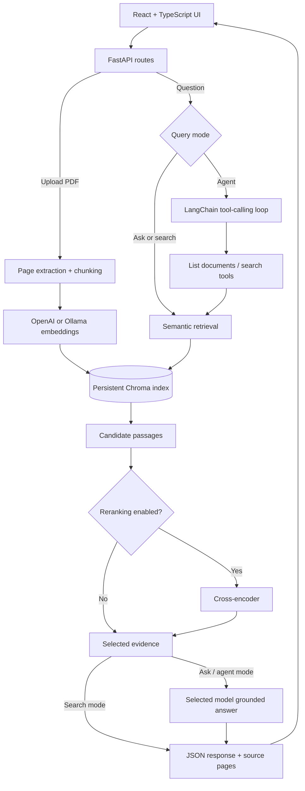

<p align="center">
  
</p>

# Contextual — PDF RAG workspace

A beginner-friendly, end-to-end app for asking questions about PDFs. Upload a document, index its text, retrieve relevant passages, and get an answer with page-level evidence.

**Frontend:** React + TypeScript + Vite. **Backend:** Python + FastAPI. **RAG:** LangChain + ChromaDB + OpenAI or Ollama. LangChain is the only orchestration framework. The code uses small components, simple functions and direct API calls.

## Features

- Multi-PDF upload with size, format, encryption and page-count checks.
- Page-aware extraction, overlapping chunks, local embeddings and persistent indexing.
- Semantic search, source passages, filenames, page numbers and cosine distances.
- Answers grounded in retrieved excerpts; no API key required with local Ollama.
- Optional cross-encoder reranking of 12 candidates down to 4 passages.
- Read-only tool-calling agent with document listing, search, query reformulation and visible tool trace.
- Document filtering, duplicate detection, index deletion and useful loading/error states.
- Responsive React UI, typed API contracts, automated tests and a sample PDF.

## Architecture



Agent tool results return to the planning model for up to three rounds before the final grounded answer. It can perform at most six tool calls; a fallback search runs if it collected no evidence. The agent has no shell, browser or write tools.

## Prerequisites

Install **Python 3.12** and **Node.js 22.12+** (or Node 24). For local mode, also install [Ollama](https://ollama.com/download). Run commands in the indicated folders. First-time package and model downloads require internet access and several GB of disk space. CPU inference works, but model speed depends on your hardware.

## Choose OpenAI or Ollama

In `backend/.env` (copy `.env.example` first):

```dotenv
MODEL_PROVIDER=auto
OPENAI_API_KEY=your-real-key-here
OPENAI_CHAT_MODEL=gpt-4o-mini
OPENAI_EMBEDDING_MODEL=text-embedding-3-small
```

- **Key present + `auto`:** OpenAI supplies both embeddings and answers, including agent tool calling. You do not need Ollama or local model downloads for this mode. Install Python/Node dependencies and start the backend/frontend using the commands below.
- **Key empty + `auto`:** local Ollama supplies both models. Follow the model-download commands below.
- **`MODEL_PROVIDER=ollama`:** force local models even when an OpenAI key exists.
- **`MODEL_PROVIDER=openai`:** require OpenAI; a missing key produces a clear configuration error.

Restart FastAPI after changing `.env`. Keep the key only in the backend `.env`, which is gitignored; there is no browser key-entry form. OpenAI usage requires API billing and sends your question and document text to OpenAI. A ChatGPT subscription does not supply API credits.

An invalid key, exhausted quota or OpenAI outage produces an error; the app does not silently switch providers mid-request. Automatic selection happens at startup based on whether the key is present. Switching embedding providers selects a separate index: upload PDFs again for the new provider. Your existing Ollama index is preserved.

## Setup on Windows — PowerShell

Extract the ZIP and open a terminal inside `contextual-rag`.

**1. For Ollama mode, download the models.** Skip this step when using an OpenAI key. Keep Ollama running for local mode.

```powershell
ollama pull nomic-embed-text
ollama pull qwen2.5:3b
```

If the Ollama desktop app is not running, run `ollama serve` in another terminal. Do not start a second server if one is already listening.

**2. Start the Python backend.**

```powershell
cd backend
py -3.12 -m venv .venv
.\.venv\Scripts\python.exe -m pip install -r requirements.txt
Copy-Item .env.example .env
.\.venv\Scripts\python.exe -m uvicorn src.api:app --reload --host 127.0.0.1 --port 8000
```

**3. Open another terminal in `contextual-rag` and start React.**

```powershell
cd frontend
npm ci
npm run dev
```

Open **http://localhost:5173**. The backend's interactive API documentation is at **http://127.0.0.1:8000/docs**. Keep both terminals running, plus Ollama when using local mode.

## Setup on macOS / Linux

For local mode, download the same two Ollama models. For OpenAI mode, set your key in the copied `.env` before starting the backend. Then:

```bash
# Terminal 1, from contextual-rag
cd backend
python3.12 -m venv .venv
source .venv/bin/activate
pip install -r requirements.txt
cp .env.example .env
uvicorn src.api:app --reload --host 127.0.0.1 --port 8000
```

```bash
# Terminal 2, from contextual-rag
cd frontend
npm ci
npm run dev
```

Vite forwards `/api` requests to FastAPI. This avoids browser CORS setup in local development. Never put model credentials or private settings in frontend code.

## Try it in five minutes

1. Upload `data/sample_handbook.pdf`. Wait for indexing to finish.
2. Choose **Semantic search** and search `How much time off can employees take?`.
3. Choose **Ask documents** and ask `How many days of annual leave are provided?`. The sample says **24 days**, page 1.
4. Ask `What is the reimbursement limit for learning?`. The sample says **INR 15,000 per year**, page 2.
5. Open the source cards to inspect the original passages.
6. Choose **Agent mode** and ask `Compare the leave and learning policies`. Inspect its tool execution steps.
7. Ask `What is the company's revenue?`. That information is absent; the model is instructed to acknowledge insufficient evidence.
8. Restart the backend: the index persists. Upload identical bytes again: duplicate indexing is skipped.

Every question is standalone. There is no multi-turn conversation memory. The UI clears prior results when you change document scope or mode.

## Enable optional reranking

From `backend`, with your Python environment active:

```bash
pip install -r requirements-rerank.txt
```

On Windows without activation, use `.\.venv\Scripts\python.exe -m pip install -r requirements-rerank.txt`. Restart the backend and enable **Rerank results**.

This uses `cross-encoder/ms-marco-MiniLM-L-6-v2`, downloaded from Hugging Face on first use. Unlike a vector lookup, it reads each query–passage pair together and assigns a new score. It adds PyTorch dependencies and latency; the default is off. This reranker is English-focused.

## How RAG works here

| Step | What the code does | Why |
|---|---|---|
| Extract | pypdf reads text one page at a time | Keeps source page numbers |
| Chunk | Recursive splitter, 1,000 characters with 150 overlap | Fits useful passages into context |
| Embed | The selected provider maps each chunk into a numeric vector | Represents semantic meaning |
| Index | Chroma stores vectors, text and metadata on disk | Avoids reprocessing every question |
| Retrieve | Embed the question, find 12 nearby vectors using cosine distance | Finds potentially relevant evidence |
| Rerank | Optionally score query–passage pairs again | Refines the ordering |
| Select | Keep 4 source chunks | Limits context size |
| Generate | Send question and labeled excerpts to the selected LLM | Produces a grounded answer |

Chunks do not cross page boundaries. Chunk sizes are **characters, not tokens**. Metadata stores the file hash, filename, 1-based page number, character offset and chunk ID. Identical file bytes count as the same document even if renamed.

Cosine distance is smaller for closer vectors; cross-encoder scores are larger for higher-ranked pairs. Neither score is a confidence percentage. There is no calibrated relevance cutoff: unrelated questions may still retrieve passages. Abstention and citation correctness require model evaluation.

## Understand the code

```text
contextual-rag/
  frontend/
    src/
      App.tsx                     Page state and user actions
      api.ts                      Fetch requests and network errors
      types.ts                    TypeScript API contracts
      components/
        DocumentPanel.tsx         Upload, scope and document removal
        QuestionPanel.tsx         Modes, question input and reranking
        AnswerPanel.tsx           Markdown answer, sources and tool trace
      styles.css                  Responsive UI styling
      App.test.tsx                User-flow tests
    vite.config.ts                Development API proxy
    package.json                  Frontend dependencies and commands
  backend/
    src/
      api.py                      FastAPI HTTP routes
      schemas.py                  Request/response validation
      config.py                   Environment settings
      ingest.py                   PDF extraction and chunking
      models.py                   OpenAI / Ollama model factories
      engine.py                   Indexing, retrieval, reranking and answers
      agent.py                    Read-only tool-calling loop
    tests/                        Pipeline and API tests
    requirements.txt              Bounded runtime dependencies
    requirements.lock.txt         Exact validated core/dev dependency snapshot
    .env.example                  Configuration template
  data/sample_handbook.pdf         Sample two-page document
  docs/BEGINNER_GUIDE.md            Suggested code-reading order
  docs/VALIDATION.md                Testing results and limitations
  docs/REPOSITORY_CHANGES.md        Changes from your original repository
```

Read `docs/BEGINNER_GUIDE.md` first if these concepts are new. React state is sufficient for this small app; global state middleware would add complexity without helping the current workflow.

## API routes

| Method | Route | Purpose |
|---|---|---|
| GET | `/api/health` | API liveness; does not verify models |
| GET | `/api/config` | Model names and upload size limit |
| GET | `/api/documents` | List indexed documents and chunk counts |
| POST | `/api/documents` | Upload one PDF as multipart `file` |
| DELETE | `/api/documents/{id}` | Delete one document's index |
| POST | `/api/query` | Search, standard RAG or agent answer |

Example `/api/query` JSON:

```json
{
  "question": "How many annual leave days are provided?",
  "mode": "ask",
  "document_id": null,
  "rerank": false
}
```

`mode` is `ask`, `search` or `agent`. Set `document_id` to an ID from `/api/documents` to search one PDF. Response fields are `answer`, `sources` and `trace`. Source entries include filename, page, excerpt and ranking scores.

## Backend configuration

Copy `backend/.env.example` to `backend/.env`; start the backend from its own folder and restart after changes.

| Variable | Default | Purpose |
|---|---|---|
| `MODEL_PROVIDER` | `auto` | OpenAI with a key, otherwise Ollama |
| `OPENAI_API_KEY` | empty | Backend-only OpenAI key |
| `OPENAI_CHAT_MODEL` | `gpt-4o-mini` | Hosted answer and tool model |
| `OPENAI_EMBEDDING_MODEL` | `text-embedding-3-small` | Hosted embedding model |
| `OLLAMA_BASE_URL` | `http://localhost:11434` | Model server |
| `CHAT_MODEL` | `qwen2.5:3b` | Answer and tool-calling model |
| `EMBEDDING_MODEL` | `nomic-embed-text` | Embedding model |
| `DATA_DIR` | `./data/chroma` | Index directory, relative to backend |
| `CHUNK_SIZE` | `1000` | Maximum characters per chunk |
| `CHUNK_OVERLAP` | `150` | Overlap target |
| `MAX_PDF_MB` | `20` | Per-file limit |
| `RERANK_MODEL` | `cross-encoder/ms-marco-MiniLM-L-6-v2` | Optional reranker |

Changing the embedding model or chunk settings selects a new collection; upload documents again. Old collections remain on disk. If model weights change under the same tag, use a new `DATA_DIR` and re-index. Changing only the chat model does not require re-indexing.

## Run checks

```bash
# From backend, with the Python environment active
pip install -r requirements-dev.txt
python -m pytest -q
ruff check .
```

```bash
# From frontend
npm test
npm run build
```

The frontend build includes TypeScript checking. The Python tests use real PDFs and persisted Chroma with deterministic test embeddings and a stub LLM. They check behavior, not real model quality. Frontend tests use mocked API responses. Read `docs/VALIDATION.md` before interpreting the results.

`npm ci` uses the included lockfile. `backend/requirements.lock.txt` records exact versions used for core/backend testing on Python 3.12/Linux. Install it instead of `requirements.txt` when you want that snapshot; the bounded requirements provide more platform flexibility. Optional reranking dependencies are separate.

## Docker alternative

For Docker with OpenAI, set `OPENAI_API_KEY` in your shell or a root `.env` (Compose reads this separately from `backend/.env`), then skip the two model-pull commands. Do not commit either `.env`. From the project root:

```bash
docker compose up -d --build
docker compose exec ollama ollama pull nomic-embed-text
docker compose exec ollama ollama pull qwen2.5:3b
```

Open **http://localhost:8080** after model downloads finish. nginx serves React and forwards `/api` to FastAPI. Models and index data use persistent volumes. This is a CPU-only option; Docker was not executed during validation. Stop with `docker compose down`. Adding `-v` also removes stored models and index data. Optional reranking requires installing its requirements in the backend image and rebuilding.

## Troubleshooting

- **Cannot reach backend:** start FastAPI on port 8000; use `npm run dev` on port 5173.
- **Model request failed:** verify Ollama is running and `ollama list` contains both configured models.
- **Slow response:** models may be loading; local CPU generation can take time. Uploads and queries show a loading indicator; answers arrive as a complete response, not streamed tokens.
- **SOCKS proxy import error:** if your own environment uses a SOCKS proxy, install `httpx[socks]` and ensure localhost is excluded from that proxy.
- **Scanned PDF:** run OCR first. Empty pages are reported. Partially scanned pages can contain missing text that this app cannot detect.
- **Tables / columns:** extracted text can be reordered. Verify source passages against the PDF.
- **Reranking unavailable:** install its optional requirements and restart.
- **Tool calling unsupported:** choose a tool-capable Ollama model. Semantic search and normal RAG do not require tools.
- **Wrong answer:** inspect retrieved passages, try a more precise question or a stronger local chat model. No accuracy percentage is claimed.

## Scope and limitations

This is a local, single-user learning/portfolio application. It does not include authentication, tenant isolation, OCR, distributed ingestion, or a production deployment setup. Run one backend worker per data directory. A shared lock prevents HTTP queries/deletions from observing partial indexing; larger multi-user systems need a different concurrency design.

Original PDFs are parsed in memory and not retained by the app. Text and embeddings persist on the backend machine. In OpenAI mode, document text is sent to OpenAI for embeddings and answer generation. With localhost Ollama, model processing stays local. Setting a remote model URL sends the text to that server. Optional reranker/model/package downloads need internet access. The UI uses Google Fonts with local fallback fonts; this does not send PDF content to Google.

The backend limits files to 20 MB and 500 pages, but multipart parsing happens before the route's size check. Use trusted PDFs for this local project. External deployment would need upstream request limits, authentication, resource isolation and rate limiting.

Citations are prompted and displayed with evidence; their factual correctness is not mechanically verified. Document instructions are treated as untrusted in the system prompt, but prompt injection is not fully solved. The defaults target English; evaluate multilingual models before using Telugu documents.

## Explain it in an interview

“I built a React/TypeScript frontend and a FastAPI backend for PDF RAG. The backend extracts page-level text, creates overlapping chunks, generates embeddings and stores them in Chroma. Questions retrieve candidates by cosine similarity, with optional cross-encoder reranking. The LLM answers from the selected excerpts, and the UI shows source pages. A separate mode demonstrates bounded LangChain tool calling for document search.”

Only claim measured improvements after evaluating your own data. This project provides Chroma experience; it does not implement FAISS, Pinecone or Qdrant.

## References

- [LangChain Chroma integration](https://docs.langchain.com/oss/python/integrations/vectorstores/chroma)
- [ChatOllama tool binding](https://reference.langchain.com/python/langchain-ollama/chat_models/ChatOllama/bind_tools)
- [FastAPI file uploads](https://fastapi.tiangolo.com/tutorial/request-files/)
- [Vite documentation](https://vite.dev/guide/)
- [Original repository](https://github.com/jaswanth6988/Contextual-Query-Engine-RAG-)
